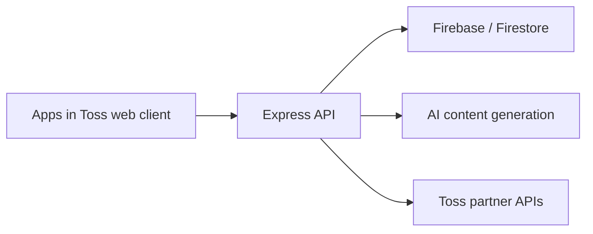

# Gacha: product and engineering portfolio

Gacha is a Korean daily-content and rewards miniapp built for **Apps in Toss**. This repository contains a sanitized snapshot of the React frontend and Node.js backend, showing how product flows connect to implementation: onboarding, AI-generated content, saved results, reward balances, attendance, and partner integrations.

I planned, built, and operated the product. The code here comes from that service; this repository includes a working browser portfolio demo and a sanitized source snapshot.

## Use the browser app

[Open Gacha](https://gacha-portfolio-alpha.vercel.app/).

The standalone browser app lets you enter a concern, choose a character, request a new AI advice card, adjust its reading size, and save/reopen/delete it in this browser's collection. It sends a same-origin request to a new server function that calls Google Cloud Vertex AI. Successful answers come from that provider; failed or unconfigured requests show an error rather than a fixed sample fallback. This browser app does not connect to Toss login, real rewards, Firebase, payments, analytics or the former production backend.

```sh
cd frontend
npm ci --ignore-scripts
npm run dev
```

Use Node.js 24 or newer. `npm run dev` runs the frontend UI only; use Vercel development or a matching local server for `/api/advice`. Build with `npm run build`; deploy from the `frontend` project directory so Vercel includes both `api/advice.js` and `dist`. The server requires `VERTEX_PROJECT_ID`, `VERTEX_LOCATION=global`, `VERTEX_MODEL=gemini-3.5-flash-lite` and `VERTEX_SERVICE_ACCOUNT_JSON`. Keep all provider credentials on the server and keep `VITE_ENABLE_RUNTIME` unset.

The adapter in [src/portfolio](frontend/src/portfolio) reuses the original `Button`, `Card`, `HistoryContentCard`, character/situation data, result-history shape and reading-size limits. The new [Vertex server function](frontend/api/advice.js) and browser adapter were added for portfolio review on 2026-10-10, rather than representing the original production backend. The collection stores up to 10 AI results in local storage only after Save. It never silently removes earlier saved answers. Earlier fixed-sample demo data uses a separate key and is not displayed as generated advice. See the [frontend setup and limits](frontend/README.md).

## Contribution scope

The product was developed and operated under my lead with AI coding tools. It also received one later frontend contribution from another developer, `rnhappysmile`, on 2026-05-20: an AI quick-ask visibility flag and an Apps in Toss SDK/package-lock update. I do not claim exclusive authorship of every commit. This public repository is a sanitized snapshot; the original repositories and their historical author records are private. Git author fields and this snapshot support a contribution review, rather than proving identity or exclusive authorship.

## Start here

| Area | Code to explore |
| --- | --- |
| Frontend composition and navigation | [App.tsx](frontend/src/App.tsx), [features](frontend/src/features) |
| Authentication and client integration | [useAuth.ts](frontend/src/hooks/useAuth.ts), [API client](frontend/src/shared/api/client.ts) |
| Reward state and client synchronization | [useRewardSync.ts](frontend/src/hooks/useRewardSync.ts), [reward economy](frontend/src/shared/constants/rewardEconomy.ts) |
| API routing | [server.js](backend/src/server.js), [routes](backend/src/routes) |
| AI content generation | [services](backend/src/services) |
| Authentication, validation, and partner requests | [utils](backend/src/utils) |



## Scope of this snapshot

- Preserves the application source and its product structure.
- Replaces operational configuration with environment variables or local/example defaults.
- Excludes credentials, customer records, payment and analytics exports, internal operational documents, deployment automation, scheduled jobs, and previous Git history.
- Excludes production artwork and other assets whose redistribution was not established. Some visual assets are therefore unavailable in this copy.

The original integrated application remains a **source-review snapshot**, not a ready-to-deploy production template. Its login, server storage, AI generation, payments, rewards, and partner integrations require your own development services and authorization. The new browser app requires its own authorized Vertex configuration; original production customer data is never needed for it or for code review.

## Local checks

Use the package-specific setup instructions below. Dependency installation and compilation are separate from testing real provider integrations. Run each package from its own directory.

- [Frontend setup](frontend/README.md)
- [Backend setup](backend/README.md)

Only public client settings belong in `VITE_*` variables. Server credentials must remain on the server. Keep local `.env` files, private keys, and service-account files outside version control.

Before publishing changes, scan both the working files and Git history with [Gitleaks](https://github.com/gitleaks/gitleaks):

```sh
gitleaks dir . --redact
gitleaks git --log-opts="--all" --redact
```

## Browser app verification — 2026-10-10

- 43 unit tests, strict TypeScript, production build, changed TypeScript lint, server syntax and Git diff checks passed.
- Anonymous public access, real Vertex advice, reading-size adjustment, Save, reload and reopening were verified. A 390px mobile viewport also generated and saved an actual café-character answer. One generation failed and succeeded on retry; no sample fallback was shown.
- Public API checks returned 200 for actual generation, 405 for GET, 403 for a different Origin and 400 for an invalid character. Gitleaks found no secrets in the published source or Git history.
- Original Toss authentication, rewards, payments and customer database integrations were not restored. The full dependency tree still reports 104 npm audit findings, including 5 critical; this change did not perform a dependency-wide security upgrade.

## Verification — 2026-09-29

- Frontend, Node.js 24: dependency installation, 23 unit tests, strict TypeScript checks, the disconnected-page build, and an opt-in build of the full application source passed.
- Backend: 4 pure-helper tests and syntax/relative-import checks for 83 JavaScript files passed.
- Live provider integrations, authenticated flows, payments, production authorization, and a full backend startup were not exercised. The backend checks do not require dependency installation.

## Rights

Source is shared for portfolio review. No open-source license or permission to redistribute excluded production assets is granted by this repository.
