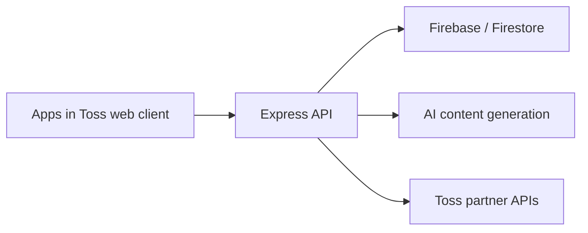

# Gacha: product and engineering portfolio

Gacha is a Korean daily-content and rewards miniapp built for **Apps in Toss**. This repository contains a sanitized snapshot of the React frontend and Node.js backend, showing how product flows connect to implementation: onboarding, AI-generated content, saved results, reward balances, attendance, and partner integrations.

I planned, built, and operated the product. The code here comes from that service; this repository includes a working browser portfolio demo and a sanitized source snapshot.

## Use the original Gacha interface

[Open Gacha](https://gacha-portfolio-alpha.vercel.app/).

The browser application mounts the original `App.tsx` with its home cards, character picker, result screens, chat, ranking page and bottom navigation. Original images and Pretendard typography have been restored. The app generates new fortunes, advice and chat answers through Vertex AI's `gemini-3.5-flash-lite`; results and conversations stay in this browser. It does not substitute fixed samples when generation fails.

The public web integration was added on 2026-10-10. It leaves Toss identity, customer Firebase access, payments, ads and real rewards disconnected. Original controls for those features explain the platform limitation. The ranking page displays an explicit empty state without invented users or historical ranking data. AI text and fortune scores are reference content, not real-person quotations or predictions.

```sh
cd frontend
npm ci --ignore-scripts
npm run dev
```

Use Node.js 24 or newer. Public browser mode is the default. `npm run dev` serves the original interface; its API proxy requires a matching local API or Vercel development to generate answers. Deploy from `frontend` so Vercel includes its server functions, original static assets and API rewrites. Server variables are `VERTEX_PROJECT_ID`, `VERTEX_LOCATION=global`, `VERTEX_MODEL=gemini-3.5-flash-lite` and `VERTEX_SERVICE_ACCOUNT_JSON`; none use the `VITE_` prefix. `VITE_PUBLIC_BROWSER=false` is only for an explicitly configured native integration with its own authorized services. See [frontend setup](frontend/README.md).

The original frontend snapshot is based on its 2026-07-07 source state. It is not presented as a reconstruction of the exact February ranking-post UI or a reopening of the terminated Toss production service.

## Contribution scope

The product was developed and operated under my lead with AI coding tools. It also received one later frontend contribution from another developer, `rnhappysmile`, on 2026-05-20: an AI quick-ask visibility flag and an Apps in Toss SDK/package-lock update. I do not claim exclusive authorship of every commit. This public repository is a sanitized snapshot; the original repositories and their historical author records are private. Git author fields and this snapshot support a contribution review, rather than proving identity or exclusive authorship.

## Start here

| Area | Code to explore |
| --- | --- |
| Frontend composition and navigation | [App.tsx](frontend/src/App.tsx), [features](frontend/src/features) |
| Authentication and client integration | [useAuth.ts](frontend/src/hooks/useAuth.ts), [API client](frontend/src/shared/api/client.ts) |
| Reward state and client synchronization | [useRewardSync.ts](frontend/src/hooks/useRewardSync.ts), [reward economy](frontend/src/shared/constants/rewardEconomy.ts) |
| API routing | [server.js](backend/src/server.js), [routes](backend/src/routes) |
| AI content generation | [services](backend/src/services) |
| Authentication, validation, and partner requests | [utils](backend/src/utils) |



## Scope of this snapshot

- Preserves the application source and its product structure.
- Replaces operational configuration with environment variables or local/example defaults.
- Excludes credentials, customer records, payment and analytics exports, internal operational documents, deployment automation, scheduled jobs, and previous Git history.
- Includes the original app static images and font needed to review this interface. Private certificates, keys and unrelated files from the original public folder remain excluded. Pretendard redistribution terms are included in [its font license](frontend/public/fonts/LICENSE.txt).

The original integrated application remains a **source-review snapshot**, not a ready-to-deploy production template. Its login, server storage, AI generation, payments, rewards, and partner integrations require your own development services and authorization. The new browser app requires its own authorized Vertex configuration; original production customer data is never needed for it or for code review.

## Local checks

Use the package-specific setup instructions below. Dependency installation and compilation are separate from testing real provider integrations. Run each package from its own directory.

- [Frontend setup](frontend/README.md)
- [Backend setup](backend/README.md)

Only public client settings belong in `VITE_*` variables. Server credentials must remain on the server. Keep local `.env` files, private keys, and service-account files outside version control.

Before publishing changes, scan both the working files and Git history with [Gitleaks](https://github.com/gitleaks/gitleaks):

```sh
gitleaks dir . --redact
gitleaks git --log-opts="--all" --redact
```

## Browser app verification — 2026-10-10

The original interface and the public integration are checked separately from the historical source snapshot. Current checks cover browser-mode startup, absence of Toss/Firebase identity access, original UI flows, API contracts, keyboard interaction and provider errors. Public release verification is recorded with the implementation commit and live browser evidence after deployment.

The full dependency tree still reports 104 npm audit findings, including 5 critical. This interface restoration does not perform a dependency-wide security upgrade. New server functions use Node standard modules and fetch.

## Verification — 2026-09-29

- Frontend, Node.js 24: dependency installation, 23 unit tests, strict TypeScript checks, the disconnected-page build, and an opt-in build of the full application source passed.
- Backend: 4 pure-helper tests and syntax/relative-import checks for 83 JavaScript files passed.
- Live provider integrations, authenticated flows, payments, production authorization, and a full backend startup were not exercised. The backend checks do not require dependency installation.

## Rights

Source is shared for portfolio review. No open-source license or permission to redistribute excluded production assets is granted by this repository.
