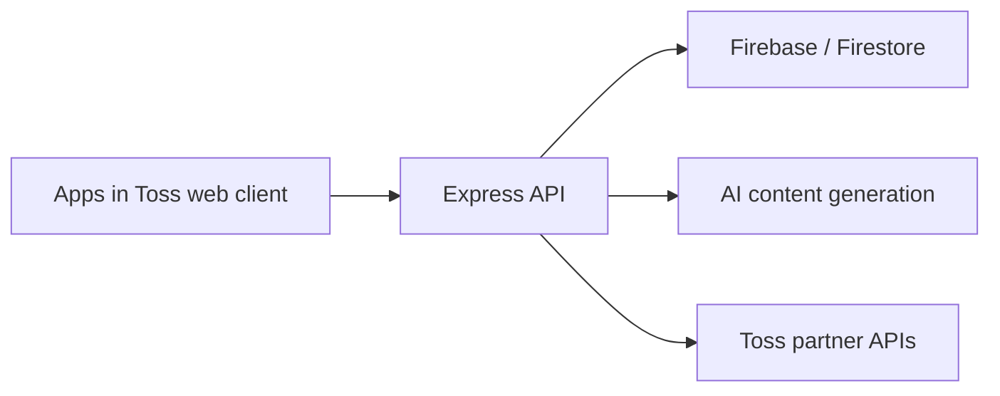

# Gacha — product and engineering portfolio

Gacha is a Korean daily-content and rewards miniapp built for **Apps in Toss**. This repository contains a sanitized snapshot of the React frontend and Node.js backend, showing how product flows connect to implementation: onboarding, AI-generated content, saved results, reward balances, attendance, and partner integrations.

I planned, built, and operated the product. The code here comes from that service; this repository is intended for reviewing the implementation and building an isolated development environment.

## Start here

| Area | Code to explore |
| --- | --- |
| Frontend composition and navigation | [App.tsx](frontend/src/App.tsx), [features](frontend/src/features) |
| Authentication and client integration | [useAuth.ts](frontend/src/hooks/useAuth.ts), [API client](frontend/src/shared/api/client.ts) |
| Reward state and client synchronization | [useRewardSync.ts](frontend/src/hooks/useRewardSync.ts), [reward economy](frontend/src/shared/constants/rewardEconomy.ts) |
| API routing | [server.js](backend/src/server.js), [routes](backend/src/routes) |
| AI content generation | [services](backend/src/services) |
| Authentication, validation, and partner requests | [utils](backend/src/utils) |



## Scope of this snapshot

- Preserves the application source and its product structure.
- Replaces operational configuration with environment variables or local/example defaults.
- Excludes credentials, customer records, payment and analytics exports, internal operational documents, deployment automation, scheduled jobs, and previous Git history.
- Excludes production artwork and other assets whose redistribution was not established. Some visual assets are therefore unavailable in this copy.

This is a **source-review snapshot**, not a ready-to-deploy production template. Login, storage, AI generation, payments, rewards, and partner integrations require your own development services and authorization. Production data and credentials are never needed to review this repository.

## Local checks

Use the package-specific setup instructions below. Dependency installation and compilation are separate from testing real provider integrations. Run each package from its own directory.

- [Frontend setup](frontend/README.md)
- [Backend setup](backend/README.md)

Only public client settings belong in `VITE_*` variables. Server credentials must remain on the server. Keep local `.env` files, private keys, and service-account files outside version control.

Before publishing changes, scan both the working files and Git history with [Gitleaks](https://github.com/gitleaks/gitleaks):

```sh
gitleaks dir . --redact
gitleaks git --log-opts="--all" --redact
```

## Verification — 2026-09-29

- Frontend, Node.js 24: dependency installation, 23 unit tests, strict TypeScript checks, the disconnected-page build, and an opt-in build of the full application source passed.
- Backend: 4 pure-helper tests and syntax/relative-import checks for 83 JavaScript files passed.
- Live provider integrations, authenticated flows, payments, production authorization, and a full backend startup were not exercised. The backend checks do not require dependency installation.

## Rights

Source is shared for portfolio review. No open-source license or permission to redistribute excluded production assets is granted by this repository.
